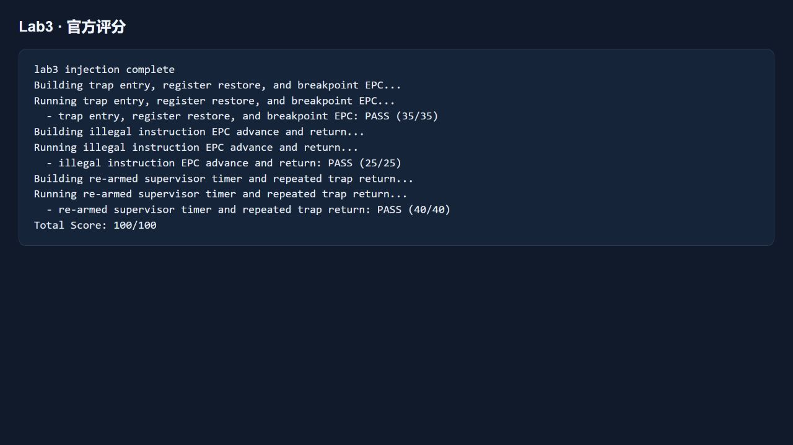
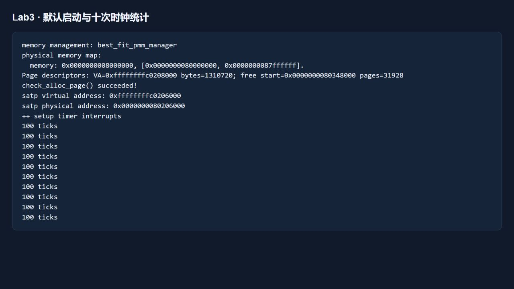
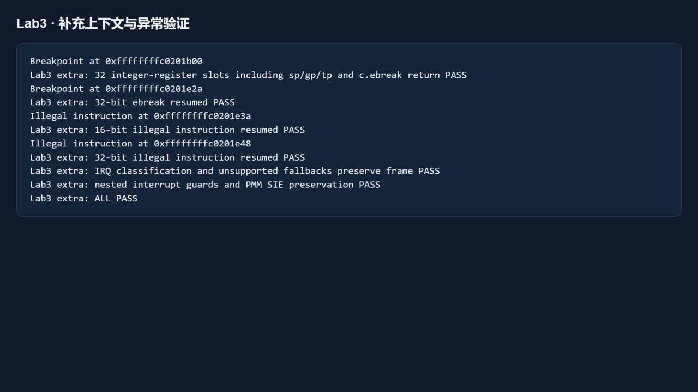
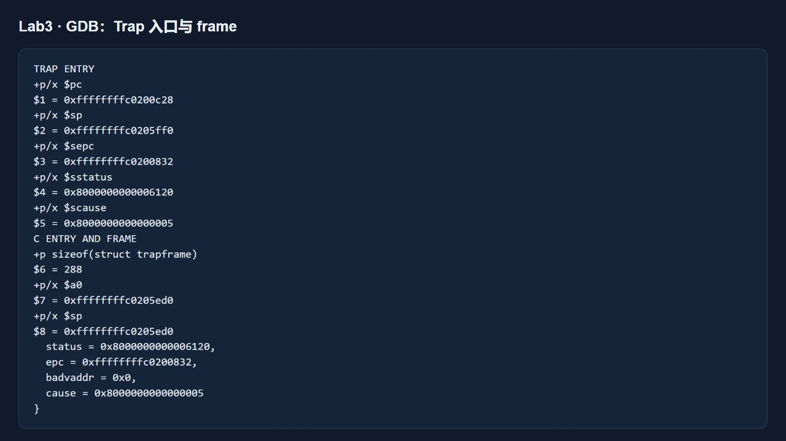
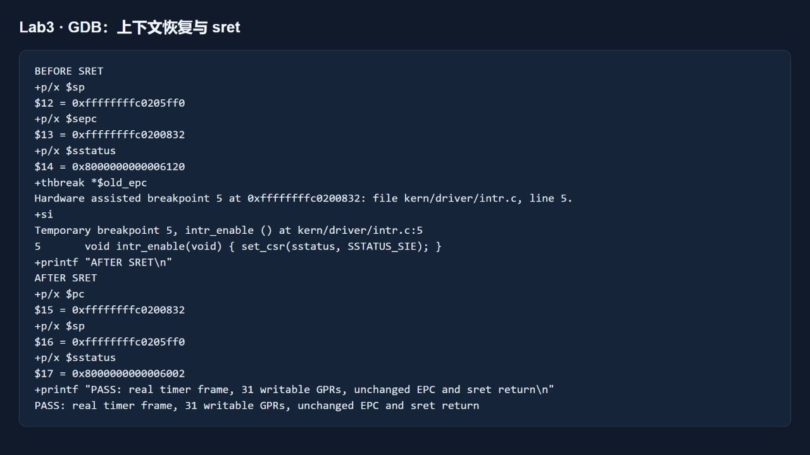

# 操作系统实验报告

## 实验基本信息

| 项目 | 内容 |
|---|---|
| 实验名称 | Lab3：中断、异常与 Trap 上下文 |
| 小组成员 | 2412396 申丰铭（组长）、2411688 马翔宇、2413992 任诗清 |
| 本次技术验证日期 | 2026-10-28 |

### 小组分工

| 成员 | 本次工作 |
|---|---|
| 申丰铭 | 统筹；提示词与规格设计，Lab2 依赖适配、Trap 入口/恢复和处理模块实现，编译评分、补充测试、GDB 验证及技术报告整理 |
| 马翔宇 | 待补充本次实际分工与复核结果 |
| 任诗清 | 待补充本次实际分工与复核结果 |

共同报告由组长整合技术过程，其他成员的实际参与内容及个人心得由本人补充；不将计划分工记为已完成经历。

## 一、实验目的

1. 理解 RISC-V Trap 的硬件进入行为、软件上下文保存和特权返回之间的分工。
2. 保持汇编 frame、C 结构体、调用约定和返回状态一致，形成完整处理闭环。
3. 实现持续时钟中断、统计输出、关机及非法指令/断点异常的可恢复处理。
4. 以模块规格约束 AI 生成代码，保留原测试并用独立断言和真实 GDB 核对结果。

课程依据：[练习要求](http://oslab.mobisys.top/lab2026/_book/lab3/lab3_2_1_exercise.html)、[报告要求](http://oslab.mobisys.top/lab2026/_book/lab3/lab3_4_lab_requirement.html)。代码使用教师发放的 lab3.zip，来源及未修改框架文件见 [source-audit.json](evidence/source-audit.json)。完整需求映射见 [requirements.md](requirements.md)。

## 二、实验环境

| 项目 | 本次环境 |
|---|---|
| 系统 | WSL2 / Ubuntu 22.04.5 LTS |
| QEMU / 固件 | QEMU 4.1.1 / 默认 OpenSBI 0.4 |
| 交叉 GCC / GDB | riscv64-unknown-elf GCC 10.2.0 / GDB 12.1 |
| 内核目标 | RV64GC / LP64D，单 hart，默认 128 MiB RAM |
| 分支与目录 | lab3；code/ 与 report/ |
| 验证构建目录 | 独立的 ~/os-course/lab3-build，不覆盖 Lab2 正式目录 |

工具原始输出见 [environment.txt](evidence/environment.txt)。

| 成员 | AI 编程工具 | 底层模型 | 说明 |
|---|---|---|---|
| 申丰铭 | Codex 桌面应用 | 本次具体型号待核对 | 本次会话读取框架、实现、运行验证和整理报告 |
| 马翔宇 | 待补充 | 待补充 | 仅记录本次实际信息 |
| 任诗清 | 待补充 | 待补充 | 仅记录本次实际信息 |

## 三、实验整体逻辑分析

### 3.1 主线

```text
entry.S 建立启动映射 → kern_init 清 BSS / 解析 DTB / 初始化控制台
 → idt_init 将 stvec 指向 __alltraps
 → pmm_init 建立物理内存管理与原有检查
 → clock_init 设置第一次事件、清零 ticks、使能 STIE
 → intr_enable 开启 SIE
 → Trap 硬件记录 sepc/scause/stval 与状态并跳转
 → SAVE_ALL 在内核栈建立 frame
 → a0=frame，调用 trap / trap_dispatch
 → 中断或异常处理
 → RESTORE_ALL / sret 返回
```

先让页和内核栈可用，再让入口能够保存、传递和恢复状态，最后才启用异步时钟；否则一次中断就可能破坏原寄存器或无法回到原执行流。教师初始化中已有两次 idt_init，第二次仍在开启时钟前，本次保留其调用结构以兼容原测试注入。

### 3.2 硬件与软件的边界

硬件保存返回 PC、异常原因和部分状态，更新 SPP/SPIE/SIE 并跳转 stvec；它不会自动把 31 个可写整数寄存器压入软件栈，也不会为本框架自动切换用户栈。SAVE_ALL/RESTORE_ALL 承担后者的上下文管理。

本次 Trap 来自 S 模式内核，保存的 SPP=1，sret 返回 S 模式。不能把 sret 一律解释为“返回用户态”；实际返回模式由保存的 SPP 决定。

## 四、实验内容与实现

### 4.1 Lab2 依赖适配

在 Lab3 的两个 lab2 标记处补入物理页初始化和 Best-Fit。原 local_intr_save/restore 包装、原子页状态宏、Page 布局与框架自检保持不变；没有把 Lab2 的完整 pmm.c 覆盖到 Lab3。

page_init 校验设备树范围、溢出、描述符容量并保留固件/内核/元数据后登记完整空闲页。Lab3 没有 Lab2 新增的物理上界宏，因此从 KERNTOP 和 PHYSICAL_MEMORY_OFFSET 推导。默认选择 best_fit_pmm_manager，保留按地址排序、最小足够块选择、分割与相邻块合并。

默认启动实际得到 32768 个 Page 描述符，每个 40 字节，数组为 1310720 字节。具体内核结束地址、描述符地址和空闲页数以 [默认运行记录](evidence/default-run.txt) 为准；它们随链接布局改变，不沿用 Lab2 的固定值。

### 4.2 功能模块一：Trap 上下文恢复与入口

负责人：2412396 申丰铭。

Trap frame 的布局由教师 SAVE_ALL 决定：

| 槽位 | 偏移（RV64） | 内容 |
|---|---:|---|
| 0..31 | 0..248 | x0..x31，其中槽 2 是 Trap 前的 sp |
| 32 | 256 | sstatus |
| 33 | 264 | sepc |
| 34 | 272 | stval / 框架名 badvaddr |
| 35 | 280 | scause |

总大小 288 字节，是 16 的倍数。__alltraps 在 SAVE_ALL 后令 a0 指向当前 frame，再调用 C trap。C 返回时 sp 回到 frame 基址，进入 __trapret。

RESTORE_ALL 使用 frame 恢复 sstatus 和 sepc，再恢复各整数寄存器，最后从槽 2 加载旧 sp。恢复中使用过的临时寄存器也从其原槽恢复，不能在读完 frame 前提前改 sp。badvaddr 和 cause 用于诊断，不需要作为执行状态写回。sret 使用恢复的 EPC 和 SPP/SPIE 完成返回。

接口不变：`void trap(struct trapframe *tf)`。原 SAVE_ALL 和 struct trapframe 保持原样。

### 4.3 功能模块二：中断处理

负责人：2412396 申丰铭。

trap_dispatch 已通过 cause 的最高位区分中断与异常，本次保留该函数。interrupt_handler 剥离中断标记后按原因分发，S timer 分支先设置下一次事件，再将 ticks 加一；每 100 次调用原 print_ticks。

指导书引用 SHUTDOWN_AFTER，但教师文件未定义该宏；在允许补全区域定义为 10，含义为输出十次统计，即累计 1000 ticks 后调用 sbi_shutdown。默认启动实际输出十行 100 ticks 后进程正常退出。没有通过删除原 print_ticks 中的评分条件或修改评分脚本实现这一结果。

其他已命名 IRQ 输出相应类型提示；未知原因输出原因和原 Trap frame。timer 不修改 tf->epc，否则会跳过被中断的原指令。

clock.c 的读时钟接口实际使用 rdtime。timebase=100000，在 QEMU 10 MHz 时间基准下名义间隔为 10 ms；处理开销、暂停调试等会影响实际墙钟耗时，不能将其等同于精确调度周期。

### 4.4 功能模块二：异常处理

接口为 `void exception_handler(struct trapframe *tf)`。非法指令和断点先取得可读内核指令的低半字，再根据编码识别 16/32 位长度，输出原 EPC 并分别推进 2/4 字节；返回后的 RESTORE_ALL 会把修改后的 EPC 写回 sepc。

补充测试分别执行 0x9002、0x00100073、0x0000、0x0000007b，覆盖压缩断点、标准断点、压缩非法指令和标准非法指令。逐一核对触发地址和异常后的执行标记。其他异常使用原 print_trapframe，不假设可以通用恢复。更长编码只诊断，未实现安全用户取指或扩展指令模拟。

### 4.5 中断屏蔽与原子操作

local_intr_save 保存 SIE 并关本 hart 中断，local_intr_restore 仅在原状态开启时恢复。嵌套进入时内层记录“原本已关”，因此内层退出不能提前开中断。补充测试验证原开/关两种状态，以及 PMM 操作后状态与页数保持。

`do { ... } while (0)` 让多语句宏在语法上表现为一条语句，可以安全用于 if/else 并在调用处加分号。volatile ticks 提醒编译器该值可异步变化，但不等于跨核同步；原子位操作也不等于空闲链表整体具有多核并发安全性。

### 4.6 真实 GDB 观测与实现迭代

使用临时硬件断点观察一次真实 S timer：__alltraps 入口、C trap 入口、__trapret、实际 sret 与原 EPC。frame 大小为 288，a0 与保存后的 sp 相等，frame 的 sp 槽与 Trap 前 sp 相等。C 返回时 ticks=1，EPC 不变；sret 前 31 个可写整数寄存器逐一与进入时比较通过。执行 sret 后，PC 回到原 EPC，sp 恢复，SIE 开启，SPP 按硬件语义清零。

实际命令和输出见 [GDB 原记录](evidence/gdb/gdb.txt)，不是只根据源码推断通过。

本次先完成四份模块规格，再生成实现；首轮核心实现通过官方评分与补充检查。工具迭代中，首次仅在 sret 处执行 si，没有观察到预期停止，随后连接在默认程序正常关机时关闭；保留 [首次记录](evidence/gdb/first-attempt-gdb.txt)。将“确认返回执行点”的要求补为原 EPC 临时硬件断点后，保持内核恢复逻辑不变，复验通过。不把没有出现的内核 bug 编入迭代经历。

此外，原 Trap frame 打印函数部分字段使用 32 位展示格式；本次保留受保护函数，通过 GDB 的 p/x 观察完整 RV64 地址，不从截断的诊断地址推导映射。

### 4.7 模块提示词

以下四份完整规格与 [prompt.md](prompt.md) 一致；测试工具的返回断点修订见上述真实迭代记录。

#### P1：继承物理页初始化和 Best-Fit

```text
[PROMPT]
将本组 Lab2 已验证的物理页初始化与完整 Best-Fit 模块适配到教师 Lab3 框架的 lab2 标记位置；当前负责人 2412396。保留 Lab3 的中断保存/恢复包装、原有宏和测试。默认接入 Best-Fit。只移植所需实现，不复制 Lab2 的整个 pmm.c，也不引入 Buddy、SLUB 或 MMU 探针。

[RELY]
Lab3 的 pmm.c/pmm.h、memlayout.h/mmu.h、dtb.h、sync.h，教师 Best-Fit 文件已有测试，以及本组 Lab2 对应实现。Lab3 的头文件没有 Lab2 新增的 PHYSICAL_MEMORY_END、KERNEL_BEGIN_PADDR，因此必须由本框架已有宏推导边界，不能直接照抄不存在的符号。Page 布局、原子状态宏和 local_intr_save/restore 必须保留。

[GUARANTEE]
page_init(void)；best_fit_pmm_manager 的 init/init_memmap/alloc_pages/free_pages/nr_free_pages/check；init_pmm_manager 选择正确实例。原 basic_check/best_fit_check 的正文保持不变。

[SPECIFICATION]
page_init 的输入为已解析的单段 DTB RAM，固定 DRAM_BASE；检查空范围、加法溢出、管理上界和描述符容量。先保留所有页，再注册排除固件、内核、描述符与对齐间隙后的完整空闲页。npage 是页号上界，描述符数量是 npage-nbase。
Best-Fit 空闲块按地址排序，选择最小的足够大块，同长度选先遇到者，精确匹配摘除，较大块分割；失败返回 NULL 且不改变状态。回收按地址插入并合并连续前后块，页数仅增加本次释放量。合法输入 n>0，调用者不得重复释放。已有框架测试和中断临界区不得绕过或改写。
验收：源码差异审计、默认编译启动、原分配器检查；由后续 Trap 检查确认新中断包装未破坏运行。
```

#### P2：完整 Trap 入口、上下文恢复与返回

```text
[PROMPT]
在 kern/trap/trapentry.S 的两个 lab3 function1 标记处实现 RESTORE_ALL 和 __alltraps 到 C trap 的桥接；将标记中的 YOUR CODE 改为 2412396。禁止修改已有 SAVE_ALL、trapframe 布局、trap 签名与 sret。覆盖模块完整职责，不以伪代码指定逐条指令顺序。输出实际修改及布局核对结果。

[RELY]
仅依赖 trapentry.S 的 SAVE_ALL、trap.h 的 pushregs/trapframe、riscv.h 的 LOAD/STORE/REGBYTES、RV64 ABI 和 S 模式 Trap 返回语义。本框架在当前内核栈保存 36 个寄存器槽位，RV64 下为 288 字节；gpr[0..31] 后依次为 status/epc/badvaddr/cause。

[GUARANTEE]
RESTORE_ALL 输入 sp 指向已保存的 trapframe，恢复 C 处理后应返回的执行状态；__alltraps 把当前 frame 指针作为 a0 调用 void trap(struct trapframe *tf)，返回后进入已有 __trapret 和 sret。

[SPECIFICATION]
SAVE_ALL 已用 sscratch 暂存旧 sp 并存入槽位 2；恢复前保持 frame 基址有效，恢复所有可写整数寄存器，最后从槽位 2 恢复 sp。不能在 frame 读取完成前改变 sp，不能把当前 frame 地址当成旧 sp。x0 恒为零。
从 frame 恢复 sstatus 与 sepc，临时寄存器也必须恢复为原值；badvaddr/cause 是记录信息，不要求写回对应 CSR。尊重 frame 中 SPP/SPIE，不强制切换到 U 模式，也不提前开启 SIE；最终特权返回由 sret 完成。当前实验验证内核 S 模式，不宣称实现用户栈切换、嵌套 Trap 或浮点/向量上下文。
传给 trap 的 a0 必须等于当前 frame 地址，C 调用前栈满足 ABI 对齐；恢复后执行点应采用 C 处理更新后的 epc。
验收：结构体槽位和汇编差异审计；未修改的官方上下文/断点测试；补充 16/32 位异常往返、sp 与寄存器状态、sret 前后 SPP/SIE/SPIE 的真实 GDB 检查。
```

#### P3：中断、异常分发后的处理模块

```text
[PROMPT]
在 kern/trap/trap.c 的 lab3 function2 标记处实现 interrupt_handler 和 exception_handler；署名 2412396。保留文件其他已有函数、宏、框架测试和评分代码。允许在标记区域增加必要 include、私有常量与辅助定义。先核对原始框架，再实现可验证行为。

[RELY]
trapframe、trap_dispatch、print_trapframe、print_ticks、clock_set_next_event、ticks、TICK_NUM、IRQ_*、CAUSE_*、sbi_shutdown。教师代码 TICK_NUM=100，但没有定义指导书提到的 SHUTDOWN_AFTER；在本模块补全区域定义 SHUTDOWN_AFTER=10，含义为输出十次统计后关机，保留 TICK_NUM 原值。

[GUARANTEE]
void interrupt_handler(struct trapframe *tf);
void exception_handler(struct trapframe *tf);
不得修改 trap_dispatch、trap、idt_init、print_ticks 等既有函数。

[SPECIFICATION]
中断：剥离 cause 的最高中断标志后分发。IRQ_S_TIMER 每次重新安排下一事件且 ticks 恰加一；每达到 TICK_NUM 的倍数调用已有 print_ticks；达到 SHUTDOWN_AFTER 次统计时调用 sbi_shutdown。定时中断不改变 tf->epc。其余框架 IRQ 类型仅输出对应类型提示；未知类型输出 Unknown interrupt: cause N 并 print_trapframe，保持 frame 不变。
异常：CAUSE_ILLEGAL_INSTRUCTION 输出 Illegal instruction at，CAUSE_BREAKPOINT 输出 Breakpoint at，包含原 epc；读取映射且可读的异常指令半字，按编码区分 16 位与 32 位，分别更新 epc+2/+4，不能把所有断点当 2 字节或全部异常当 4 字节。此 RV64GC 教学路径只承诺这两种长度，遇到更长的指令编码只输出 frame，不猜测长度恢复；不宣称完整安全取指或通用非法指令模拟。其他异常只 print_trapframe，不修改 epc 或伪造恢复。
保持原输出格式检查：Supervisor software interrupt、Unknown interrupt: cause 15、已有 frame 输出。不得靠修改测试、删断言、检测评分宏跳过逻辑来得分。
验收：原官方三项测试；正常启动十次 100 ticks 后真实关机；16/32 位断点及非法指令连续执行后到达后续标记；未知原因不修改 frame；真实 timer 的 EPC 不跳过原指令。
```

#### P4：独立验证、GDB 演示与证据记录

```text
[PROMPT]
为本次 Lab3 建立可重复运行的验证和调试工具。测试写在新工具文件或隔离临时构建树中，禁止修改教师 tools/grade.sh、inject.py、test_lab3.c/.h、test_lab3_context.S 和原 basic_check/best_fit_check。运行真实 QEMU 4.1.1，记录命令、版本、输出、退出码和断言，失败应非零退出。不要生成假终端截图。

[RELY]
最终内核源码、教师原始测试、本提示词 P1/P2/P3 的接口契约、QEMU 与交叉 GDB、nm/objdump。新测试不放 kern/test，避免与官方注入目录冲突。对原教师测试分别进行哈希审计。

[GUARANTEE]
独立默认构建/启动验证；原样 make grade；覆盖未包含于官方评分的异常长度和恢复验证；可复用 GDB 流程及原始日志；需求到验收记录的映射。

[SPECIFICATION]
T1 默认构建通过且分配器原检查通过。
T2 原官方评分逐项展示真实结果，不能把补充测试冒称官方评分。
T3 正常 timer 连续 1000 次事件，对应十行 100 ticks，之后 QEMU 通过 SBI 正常退出；单次超时或被强制杀进程不算关机成功。
T4 分别实际触发 16 位 c.ebreak、32 位 ebreak、16 位非法编码和 32 位非法自定义编码，检查 cause、旧 epc、增量、后续执行标记和寄存器；断点测试避免 GDB 软件断点把异常截走。
T5 GDB 对 __alltraps、trap、__trapret、sret 设置硬件断点，确认 frame=a0=保存后的 sp、旧 sp 在槽 2、CSR 槽偏移正确、sret 返回 S 模式且 sp 恢复。解释硬件自动保存与软件保存的边界。
T6 合成未支持异常与未知中断，检查诊断及 frame 不变；不能误把异常 cause 20 当访存指令并读取空 epc。
T7 local_intr_save/restore 前后开关状态保持，嵌套临界区不提前开中断；当前测试只针对单 hart。
输出只报告实际执行过的覆盖项，源码审计与动态验证分开记录，日志中的 PASS 必须来自断言结果。若测试脚本自身有错误，修复工具并如实记录，不修改被测实现迎合错误测试。
```


## 五、测试与验证

### 5.1 结果

| 类别 | 实际结果 | 证据 |
|---|---|---|
| 默认编译 | 通过 | [build.txt](evidence/build.txt) |
| 教师官方上下文/断点测试 | 35/35 | [grade.txt](evidence/grade.txt) |
| 教师非法指令/回退测试 | 25/25 | 同上 |
| 教师持续 timer 测试 | 40/40，总分 100/100 | 同上 |
| 正常启动及十次统计后关机 | 通过，QEMU 正常退出 | [default-run.txt](evidence/default-run.txt) |
| 补充寄存器、四类异常、回退和临界区 | 通过 | [补充摘要](evidence/extra/summary.json) |
| 真实 timer frame、寄存器、CSR 与 sret | 通过 | [GDB 摘要](evidence/gdb/summary.json) |
| 原文件与原测试保护 | 哈希/区域对照 | [源码审计](evidence/source-audit.json) |

详细输入、断言目的和覆盖边界见 [test-plan.md](test-plan.md)。官方评分没有覆盖所有补充行为，不能只用 100 分替代逐项证据。

### 5.2 测试截图











说明：以上图片为真实运行日志的展示页面截图，不是终端窗口截图。完整编译、运行、评分和补充测试记录保存在 [report/evidence/](evidence/)；完整 GDB 命令及输出保存在 [report/evidence/gdb/](evidence/gdb/)。图中展示原记录的对应节选，未改写测试输出。

### 5.3 复现

```bash
source ~/os-course/env.sh
cd ~/os-course/os-labs-lab3/code
make -j4
make qemu
make grade
make -j4
python3 tools/run_validation.py --out /tmp/lab3-extra
python3 tools/debug_trap.py --out /tmp/lab3-gdb
```

## 六、实验总结与收获

### 6.1 实验与原理的对应

| 实验内容 | OS 原理 | 本次对应和边界 |
|---|---|---|
| stvec / scause / sepc | 中断入口、分类与返回 | 硬件记录部分状态，软件负责 GPR frame |
| SAVE_ALL / RESTORE_ALL | 上下文管理 | 使同一执行流正确往返，不等于已实现进程调度 |
| SPP / SPIE / SIE / sret | 特权级与中断状态 | 当前 S→S；返回模式不能硬编码为 U |
| 重设 timer 与 ticks | 定时中断 | 尚未实现时间片调度、抢占调度器 |
| 不同指令长度的 EPC 推进 | 同步异常恢复策略 | 仅跳过教学非法指令/断点，不是通用异常恢复 |
| 中断屏蔽与原子位操作 | 临界区和并发 | 单 hart 局部中断状态，不保证 SMP 链表安全 |

### 6.2 本实验未完整覆盖的知识

用户/内核栈切换、多进程调度、系统调用 ABI、可恢复缺页、设备中断完整确认流程、嵌套 Trap、跨核同步及浮点/向量上下文均很重要，但本次没有完整实现或动态验证。

### 6.3 AI 协作与个人总结

申丰铭：本次先把 frame 布局、调用约定、EPC 长度和时钟行为写成可检验约束，再对照实际框架生成实现。官方评分、独立补充测试和 GDB 分别验证输出行为、数据状态和真实执行路径。最重要的认识是：恢复寄存器并非简单“反向抄写保存代码”，还要保证 frame 基址在整个恢复期间有效，并区分硬件返回语义与软件处理策略。

马翔宇：待补充本次实际参与、复核结果与个人心得。

任诗清：待补充本次实际参与、复核结果与个人心得。
