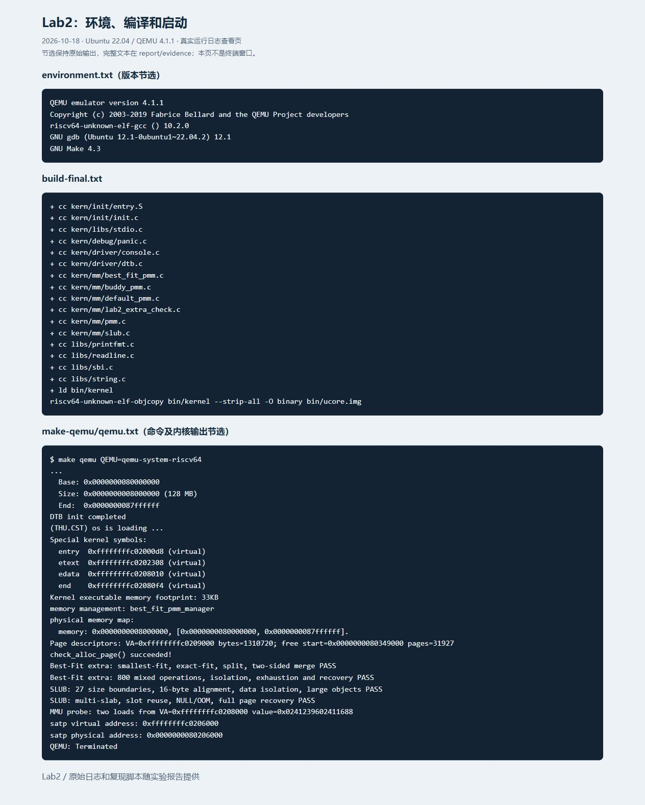
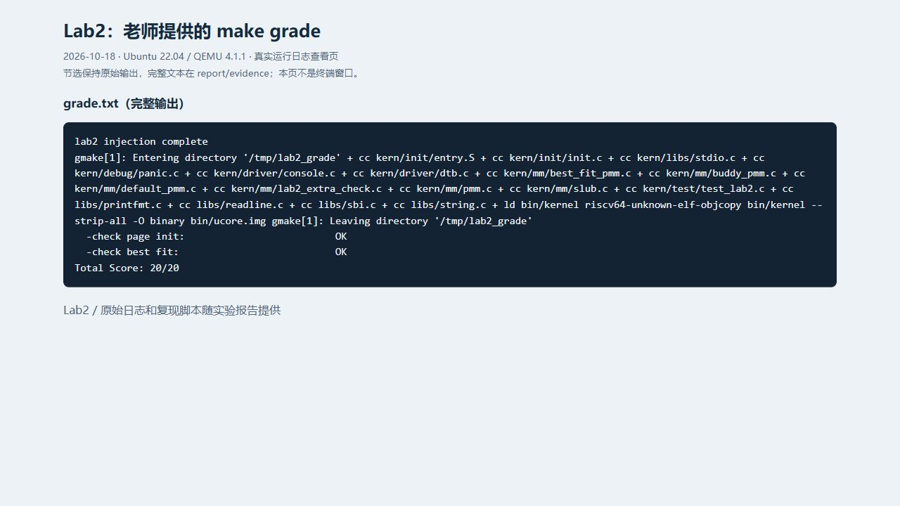
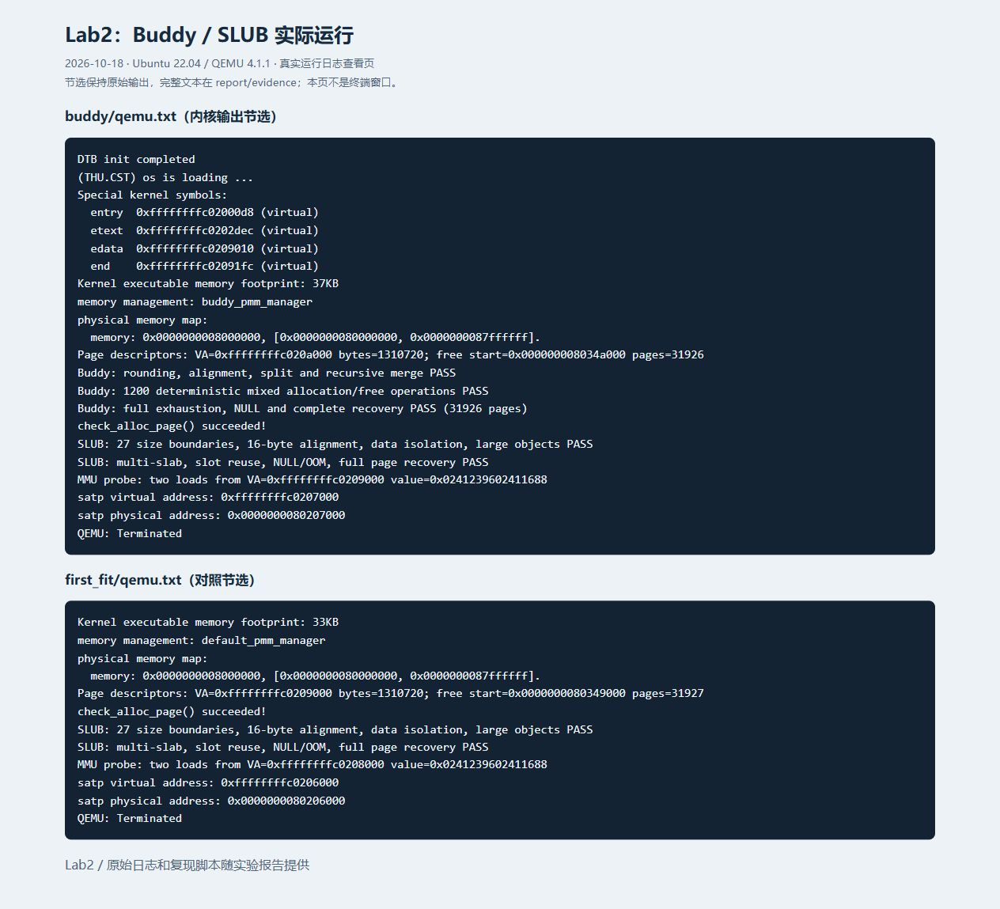
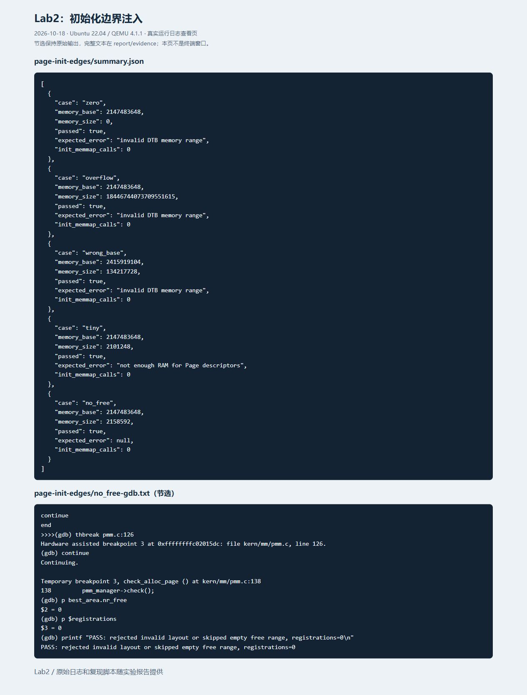
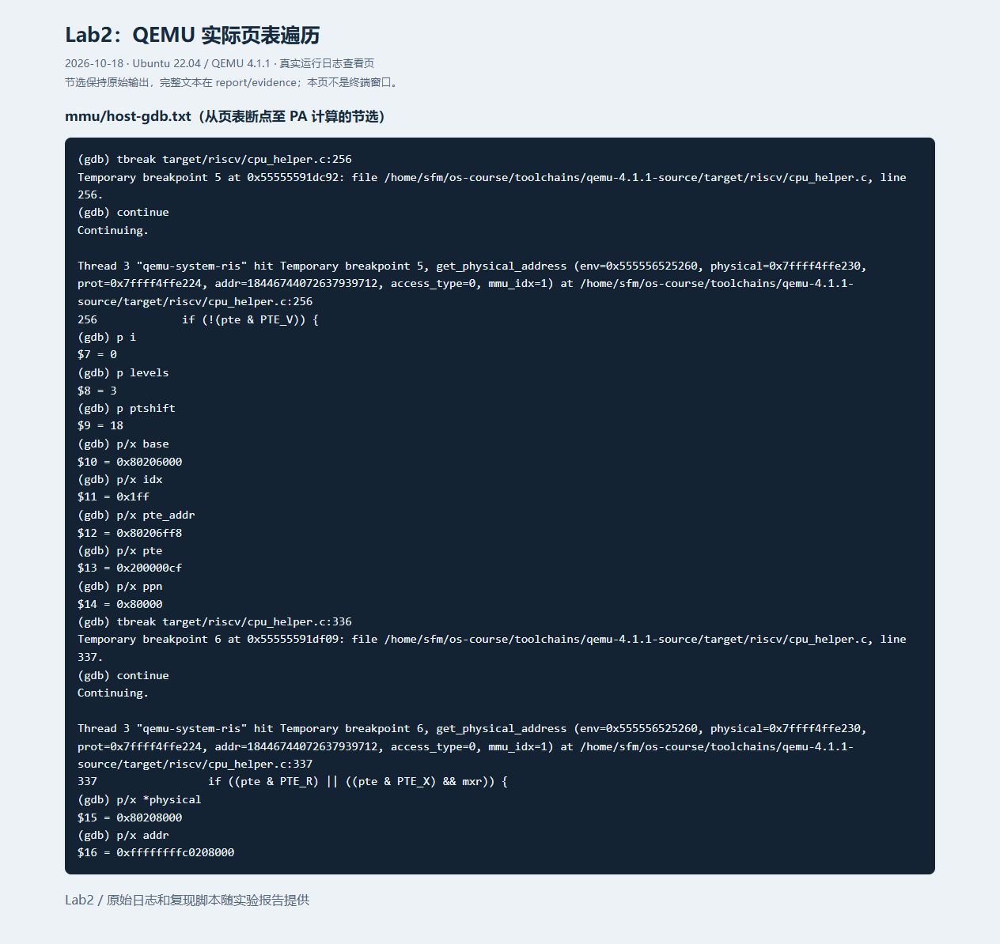
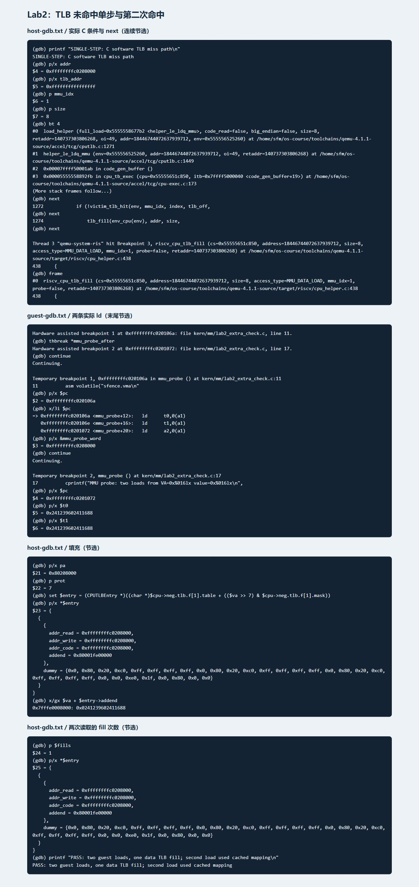

# 操作系统实验报告

## 实验基本信息

| 项目 | 内容 |
|---|---|
| 实验名称 | Lab2：物理内存和页表 |
| 小组成员 | 2412396 申丰铭（组长）、2411688 马翔宇、2413992 任诗清 |
| 实验日期 | 2026-10-18 |
| 实验分支 | `lab2` |

### 小组分工

| 成员 | 本次工作与复核安排 |
|---|---|
| 申丰铭（组长） | 统筹；使用 Codex 完成物理页初始化、Best-Fit、Buddy、SLUB、QEMU 源码调试、测试与报告整合 |
| 马翔宇 | 负责 First-Fit/Best-Fit 算法与代码复核 |
| 任诗清 | 负责 Buddy/SLUB 测试与报告复核 |


## 一、实验目的

1. 理解 RISC-V Sv39 启用后，内核虚拟地址、物理地址和页描述符之间的关系。
2. 从设备树获取 RAM 信息，预留固件、内核和管理元数据，建立可靠的物理页管理基础。
3. 理解 First-Fit，实现 Best-Fit 与 Buddy System，并比较外部碎片和内部碎片。
4. 实现简化的 SLUB 对象分配，将页级资源进一步划分成小对象。
5. 用双 GDB 从真实客体访存进入 QEMU MMU 源码，验证页表遍历和软件 TLB。

课程依据：[练习要求](http://oslab.mobisys.top/lab2026/_book/lab2/lab2_2_1_exercise.html)、[报告要求](http://oslab.mobisys.top/lab2026/_book/lab2/lab2_5_labs_requirement.html)、[QEMU 调试任务](http://oslab.mobisys.top/lab2026/_book/lab2/lab2_4_qemu_mmu_debug.html)。代码使用老师发放的 `lab2.zip`，原始文件及保留测试的核验见 [来源审计](evidence/source-audit.json)。

## 二、实验环境

| 项目 | 本次实际环境 |
|---|---|
| 系统 | WSL2，Ubuntu 22.04.5 LTS，x86_64 宿主 |
| 交叉编译器 | riscv64-unknown-elf-gcc 10.2.0 |
| 构建参数 | `-march=rv64gc -mabi=lp64d -mcmodel=medany` |
| QEMU | 4.1.1，`virt`，默认 RAM 128 MiB |
| 固件 | QEMU 内置 OpenSBI v0.4 |
| GDB | 12.1；普通 GDB 调试宿主，RISC-V GDB 调试客体 |
| Make | 4.3 |
| 调试版 QEMU | 使用同一 4.1.1 源码在独立目录 `--enable-debug` 构建，无须替换现有安装 |

完整环境和 ELF 信息见 [environment.txt](evidence/environment.txt)。生成的是 RISC-V 裸机内核，运行在模拟开发板上。`bin/kernel` 为带符号的 ELF，`bin/ucore.img` 为 QEMU 装入的裸镜像。

| 成员 | AI 编程工具 | 底层模型 | 本次说明 |
|---|---|---|---|
| 申丰铭 | Codex 桌面应用 | GPT-6  | 本次会话读取工程、实现、编译、调试和整理报告 |
| 马翔宇 | Codex | GPT-6 | 辅助理解 First-Fit、Best-Fit 算法，分析空闲链表操作、内存碎片问题及代码逻辑 |
| 任诗清 | Codex | GPT-6 | 无特别说明 |

## 三、实验整体逻辑分析

### 3.1 逻辑主线

```text
QEMU 装入 OpenSBI 和内核 → OpenSBI 以 S-mode 进入内核
 → entry.S 保存 hartid/DTB 地址、设置 satp、刷新 TLB、进入高地址 C 入口
 → 清零 BSS → dtb_init 解析 RAM
 → init_pmm_manager 选择页分配器 → page_init 预留和登记物理页
 → 分配器自测 → SLUB 对象分配测试 → MMU 访存观测
```

分页先于 C 层物理页管理初始化。启动页表已静态准备好，物理页分配器负责管理可用页，不负责在这里新建完整的进程地址空间。QEMU 在 CPU 执行前装入固件与镜像；OpenSBI 完成固件初始化并移交控制权。

### 3.2 地址和资源的逐步建立

内核链接起点为 `0xffffffffc0200000`，装载物理地址为 `0x80200000`，偏移为 `0xffffffff40000000`。启动根页表第 511 项为 `0x200000cf`，将高地址的 1 GiB 区间映射到从 `0x80000000` 开始的物理区间。它是根级叶子，因此不是每次都必须访问三级页表。

1. 设备树先给出内存范围，才能知道管理对象边界。
2. `page_init` 排除占用空间并建立描述符，才能把真正可用页交给分配器。
3. 页分配器通过统一 `pmm_manager` 提供连续页，再作为 SLUB 的底层资源。
4. 最后使用真实访存串起指令、TLB、页表与物理内存，把抽象机制和模拟器实现对应起来。

## 四、实验内容与实现

### 4.1 功能模块一：物理内存初始化

**主要函数：** `static void page_init(void)`，位于 `code/kern/mm/pmm.c`。规格与最终提示词为 P1，完整内容见本节后面的提示词附录和 [prompt.md](prompt.md)。

#### 行为规格与实现

前置条件是分页、BSS 清零、DTB 解析和空分配器初始化已完成；后置条件是所有可管理物理页均有描述符，保留区不可分配，剩余完整页已登记。

实现分为：校验设备树起点、大小和加法溢出；取设备树末端与框架管理上界的较小值并向下对齐；设置虚实偏移；在 `end` 后按页对齐放置描述符；在写描述符之前检查数组能否放入 RAM；将全部描述符预置为保留；将数组末尾向上对齐后的非空完整区间注册给当前管理器。

```c
npage = PPN(ROUNDDOWN(min(mem_base + mem_size, PHYSICAL_MEMORY_END), PGSIZE));
// 上式为关系式，实际代码通过条件表达式取较小值。
descriptor_count = npage - nbase;
pages = ROUNDUP(end, PGSIZE);          // 虚拟地址
free_begin = ROUNDUP(PADDR(pages) + descriptor_count * sizeof(struct Page), PGSIZE);
```

`npage` 是页号上界；实际 RAM 页数为 `npage-nbase`。`pages[i]` 对应物理页号 `nbase+i`，不是描述符自身所在物理页。`end` 是虚拟地址，必须通过 `PADDR` 后再与物理内存边界计算。

默认 128 MiB 实测：

| 项目 | 实测值 |
|---|---|
| RAM | `[0x80000000,0x88000000)` |
| `nbase` / `npage` | `0x80000` / `0x88000` |
| `sizeof(struct Page)` | 40 字节 |
| 描述符数量 / 数组大小 | 32768 / 1310720 字节 |
| `end` | `0xffffffffc02080f4` |
| `pages` | `0xffffffffc0209000` |
| 空闲起点 / 初始空闲页数 | `0x80349000` / 31927 |

固件区 `[0x80000000,0x80200000)`、内核镜像、描述符数组及对齐间隙都不加入空闲链表。框架仅管理以固定 DRAM_BASE 开始的单段 RAM，不宣称支持任意多段平台；设备树解析完成后不再使用其内存内容。

#### 初始化边界验证

通过独立启动、在 `pmm_init` 入口修改 DTB 查询结果，分别验证零大小、加法溢出、错误起点、放不下描述符的极小内存；均在写数组和注册空闲区前进入预期 panic。构造 `memory_size=0x20f000` 的情形，描述符放得下但无剩余完整页，`page_init` 返回时空闲数为 0，`init_memmap` 调用数为 0。此项仅验证初始化边界，停在分配器自测之前，不表示零空闲页能完成后续正常自测。详见 [边界摘要](evidence/page-init-edges/summary.json)。

64 MiB 启动正常；256 MiB 的探测范围保留真实大小，但管理上界按框架限制裁剪为 `0x88000000`。不把超出启动框架可管理范围的 RAM 错交给分配器。

### 4.2 思考题：硬件可用物理内存范围如何获取

优先使用固件/引导器提供的结构化内存描述，例如 RISC-V 的 DTB `memory/reg`、UEFI memory map 或 x86 BIOS E820。除了范围，还应读取保留区、设备 MMIO 和平台约束；多个区间分别登记，并排除内核、固件及管理元数据。不能简单地往递增地址试写来“探测”所有内存，因为可能破坏数据、触发总线异常或访问有副作用的 MMIO。确有必要的平台探测也必须遵循硬件规范。本实验使用 DTB，并受固定映射范围约束。

### 4.3 功能模块二任务一：理解 First-Fit

`default_init` 初始化空闲链表和计数。`default_init_memmap` 清除输入可用页的保留标记和引用计数，用块头的 `property` 表示连续页数，将空闲块按地址插入。`default_alloc_pages` 从表头开始，找到第一个长度不小于请求的块；正好匹配则摘除，较大则分割，计数减去请求页数。`default_free_pages` 将释放区按地址插回，并分别判断前驱末端和后继起点是否相邻，合并连续空闲块。

**改进空间：** 线性查找最坏 O(B)，可增加大小索引、分级空闲链表或平衡树；Next-Fit 可避免总从表头查找，但不保证更低碎片。延迟合并、批量分配、局部缓存可减少频繁操作成本；策略应结合请求分布和碎片率实测。物理连续分配仍可能因外部碎片失败，总空闲数足够并不代表有足够长的连续块。

### 4.4 功能模块二任务二：Best-Fit

接口为 `best_fit_init`、`best_fit_init_memmap`、`best_fit_alloc_pages`、`best_fit_free_pages`、`best_fit_nr_free_pages` 和注册对象 `best_fit_pmm_manager`。最终提示词 P2。

空闲块依然按地址有序，方便合并；分配时扫描整个链表，选择可满足请求且长度最小的块，恰好匹配立即停止。相同长度选择地址更小者。分配后清除旧块头属性，剩余段设置新头和长度；释放时按地址插入，再合并左右相邻区间。扫描顺序和选择条件不能混淆：按地址维护链表不等于 First-Fit。

老师的 `basic_check`、`best_fit_check` 完全保留。它们会暂存、重置、恢复 `free_list` 和 `nr_free`，所以使用同名宏映射至本模块状态，而不建立测试之外的另一套计数。`pmm.c` 默认注册 Best-Fit，确保官方评分检查的是新实现。

**额外测试：** 从 24 页池中分别释放 6、3、4 页块，依次申请 3、2、2 页，断言选中 3 页块、4 页块及其剩余 2 页；再回收和合并。800 次固定种子的混合操作检查活动区间不重叠和内存数据，最后请求全部空闲页，验证已完整合并、耗尽时返回 NULL，以及全量归还后计数恢复。

**改进空间：** B 为空闲块数，当前分配和释放插入均为 O(B)，额外辅助空间为 O(1)，空闲链表节点复用 Page 描述符字段。Best-Fit 减少本次剩余量，却可能留下难以复用的小孔，并不保证全局最优。可以维护 `(长度,地址)` 平衡树加地址索引，实现更快的选块与邻接合并；也可采用大小分级和小余量避免切分策略，代价是增加内部碎片或元数据复杂度。

### 4.5 功能模块二任务三：Buddy System

最终提示词分为 P3（实现）和 P4（测试）。`buddy_pmm.c/.h` 从零实现；通过 `make PMM=buddy` 选择，提交默认不变。

按阶维护 0 到 15 的空闲链表，order=k 表示 `2^k` 页。初始化把非对齐、非 2 的幂长度的空闲区拆为合法对齐块，不丢失边缘页。分配将请求上取整，找到首个非空的较大阶并反复二分。释放检查块头、实际长度、物理对齐和分配标记，然后按 `buddy_ppn = ppn XOR (1<<order)` 寻找真正同阶伙伴，只有伙伴也空闲且大小相同时才递归合并。

接口的 `alloc_pages(n)` 允许返回至少 n 页。3 页请求实际占 4 页，释放必须用该分配返回的块头和原请求或实际块大小；不支持只释放已分配 Buddy 块的一部分。计数按实际页数变化。伙伴使用绝对物理页号计算，避免把描述符数组起点误当物理对齐原点。

测试覆盖如下：

| 测试 | 检验目标 |
|---|---|
| 3 页与 9 页请求 | 分别占 4/16 页、物理对齐、拆分、递归合并 |
| 1200 次混合操作、32 个活动槽 | 非重叠、真实数据首尾完整、不同阶交错回收 |
| 逐页耗尽全部初始空闲页 | 边缘页没有丢失、计数正确、NULL 路径 |
| 全部归还和超阶请求 | 状态完全恢复、过大请求不破坏状态 |
| 空闲链表审计 | 长度、对齐、界限、互斥、计数守恒、无可继续合并伙伴 |

这组测试同时检查对外结果和内部不变量，能暴露只打印成功、只处理对齐大区间、错误伙伴计算、遗漏合并及页数泄漏等缺陷。它是本组设计的测试，不属于官方 20 分脚本。

### 4.6 Challenge：简化 SLUB

最终提示词 P5（实现）、P6（测试）。通过底层物理页分配器申请页，在页内存放 slab 头、位图和对象区。16、32、64、128、256、512、1024、2048 字节共 8 个大小类，小对象使用单页 slab，容量扣除管理头之后再计算；超过 2048 字节的对象使用连续页，记录所申请的页数供释放。

`kmalloc` 从已有 slab 找空槽，无空槽才申请新页；对象至少 16 字节对齐。`kfree` 检查 magic、大小类、槽范围与位图，清除对象位；slab 全空则立即归还页。大对象释放原页块。零大小、溢出和 OOM 返回 NULL，`kfree(NULL)` 不做操作。

这是体现“页分配 → 对象缓存”两层思想的教学简化版，使用位图和大小类链表，不含 Linux SLUB 的 per-CPU freelist、NUMA、并发同步和完整调试设施。它可在三种底层 PMM 下运行。此处仅支持单 hart 启动期调用，不宣称可直接用于并发内核。

测试同时申请 27 个边界大小对象，逐字节写入不同数据并检查互不重叠；包括 2048/2049、4096、8193 的跨界请求。270 个 16 字节对象保证跨 slab，释放最后一个槽再申请，断言精确复用且其他对象内容不变；最后检查全部页面归还。零大小、整数溢出、超出可分配内存、NULL 释放路径也有独立断言。

### 4.7 分支任务：QEMU MMU/TLB 双 GDB 调试

最终提示词 P7。先以 `--enable-debug` 独立构建 QEMU 4.1.1。宿主 GDB 启动自己的 QEMU 子进程，客体 RISC-V GDB 经端口 1235 连接；两者控制目标不同。用宿主 GDB 启动子进程可避免修改 ptrace 系统设置。

#### 调试流程与各步观察目标

调试按以下顺序进行；[调试脚本](../code/tools/debug_mmu.py) 自动驱动相同的 GDB 操作，启动命令见第 5.3 节，实际命令及输出见宿主、客体日志。

1. **准备可调试程序。** 编译默认 Best-Fit 内核和带符号的 QEMU 4.1.1。普通 GDB 调试 QEMU 进程，RISC-V GDB 加载 `bin/kernel` 并连接 QEMU 的客体调试端口；两者分别观察模拟器实现和客体指令。
2. **建立 Bare 模式对照。** 在 `riscv_cpu_tlb_fill` 对地址 `0x80200000` 设置条件断点，检查 `satp=0`，进入 `get_physical_address` 后核对输出 PA 仍为 `0x80200000`，确认未开启分页时的直通分支。
3. **定位真实访存。** 客体 GDB 在 `mmu_probe_load` 和 `mmu_probe_after` 设置临时硬件断点。前者位于 `sfence.vma` 后的第一条 `ld`，先确认指令及 `mmu_probe_word` 的实际地址，再继续执行；后者用于检查两条读取都已完成。
4. **观察 TLB 未命中路径。** 宿主按目标 VA 和数据读取类型设置条件断点，在 `load_helper` 查看 `addr`、`tlb_addr`、`mmu_idx`、读取大小及调用栈。使用 `next` 经过主 TLB 检查、victim TLB 检查和填充调用，定位 `riscv_cpu_tlb_fill`，并查看填充前的条目。
5. **单步查询页表。** 进入 `get_physical_address`，核对 `satp` 和根表基址；用 `next` 跟踪 `base + idx * ptesize`、PMP 校验、PTE 读取、PPN 提取、叶子及权限判断、大页对齐和 A/D 检查，再查看组合后的 PA。本次根级即为叶子，只读取一个 PTE。
6. **核对填充结果。** 在 `tlb_set_page` 完成后检查 `pa`、`prot` 和有效的 `CPUTLBEntry`，再用 VA 与 `addend` 得到宿主内存地址并读取内容。客体 PA 与宿主地址分开记录。
7. **验证第二次命中。** 继续到客体的后断点，比较 `t0`、`t1` 的实际值；同时统计该 VA 的数据填充次数。两次读取结果相同、条目已有效且数据填充次数为 1，共同证明第二次使用缓存映射。
8. **保存和复核证据。** 保存完整 GDB 命令、回溯、变量值和摘要；将实测分支与源码分析区分，未实际触发的非法 PTE、权限错误等分支不记为已运行通过。

2026-10-21 在原断点观测基础上补做了源码逐行单步：从 `load_helper` 的 `if (!tlb_hit(...))` 经 victim 检查进入填充，再用 `next` 经过 PTE 地址计算、PMP 校验、PTE 读取、叶子/权限/大页对齐及 A/D 分支，到物理地址组合。完整日志包含实际 `next` 命令；摘要中的 `page_walk_single_step` 和 `tlb_c_miss_single_step` 均为 true。内核 C/汇编实现未改变。


#### 实测调用路径

```text
客体 ld → TCG 生成的 x86_64 软件 TLB 快路径
  未命中 → helper_le_ldq_mmu → load_helper
  → victim_tlb_hit（仍未命中）→ tlb_fill → riscv_cpu_tlb_fill
  → get_physical_address → PMP 检查 → tlb_set_page
  → 用宿主内存地址完成读取
```

真实回溯见 [host-gdb.txt](evidence/mmu/host-gdb.txt)。TLB 命中时通常直接执行生成的宿主机器码，不会每次进入 C 的 `load_helper`；生成该快路径的 C 代码位于 `tcg/i386/tcg-target.inc.c:tcg_out_tlb_load`。C 慢路径和相应分支位于 `accel/tcg/cputlb.c:load_helper`，目标架构的页表遍历位于 `target/riscv/cpu_helper.c:get_physical_address`。

#### Bare 模式对照

在客体第一次执行 `0x80200000` 时，`mmu_idx=1`、`satp=0`，`get_physical_address` 走 Bare 分支，得到 PA `0x80200000`。即使尚未开启分页，QEMU 仍用软件 TLB 缓存客体地址到宿主内存的映射；这不同于把真实硬件 TLB 仅理解为“当前虚拟页到物理页”的查询表。

#### Sv39 页表遍历实测

内核 `mmu_probe` 在 `sfence.vma` 后连续两次 `ld` 读取 `mmu_probe_word`，客体断点停在这对指令前后。第一次读取在宿主条件断点中捕获：

| 变量 | 本次实际值 |
|---|---|
| `ld` 地址 / 第二条 `ld` 地址 | `0xffffffffc020106a` / `0xffffffffc020106e` |
| 访问 VA | `0xffffffffc0208000` |
| 访问类型 / 特权 | 8 字节读取，S-mode |
| `satp` | `0x8000000000080206` |
| 根页表物理地址 | `0x80206000` |
| 循环 `i` / `levels` / `ptshift` | 0 / 3 / 18 |
| 根索引 `idx` / PTE 地址 | 511 / `0x80206ff8` |
| PTE / PPN | `0x200000cf` / `0x80000` |
| 结果 PA / QEMU 权限 | `0x80208000` / 7（读、写、执行） |

`satp` 高 4 位为 8，表示 Sv39；低位 PPN 左移 12 得根地址。按 VA 的 VPN[2] 查根项，`0x80206000+511*8=0x80206ff8`。PTE 的 V、R、W、X、A、D 都有效，U=0；它在根级即为叶子，物理页号低 18 位为 0，满足 1 GiB 大页对齐。

本次计算为：

```text
vpn = VA >> 12
PA_page = (PTE_PPN | (vpn & ((1<<18)-1))) << 12
PA = PA_page | (VA & 0xfff)
   = 0x80208000
```

一般 Sv39 有 3 级，当前 1 GiB 叶子只读一项，不能为了展示三级而伪造后两级访问。

#### 关键分支和检查

1. M-mode/Bare 等情况地址直通；Sv39 才建立遍历参数并检查规范虚拟地址。
2. V=0 为无效项；R/W/X 全 0 表示非叶子，下一级表地址来自 PPN。
3. 叶子检查非法写权限组合、U/S 权限、SUM/MXR、访问类型和大页 PPN 对齐。
4. A/D 未设置时需要更新页表；本次 PTE 已带 A/D，因此不触发更新。
5. 成功后组合大页内 VPN 和页内偏移，检查 PMP，再填入 QEMU 软件 TLB。

本次走了合法根叶子分支；无效权限分支由源码分析说明，没有声称运行覆盖全部错误 PTE。

#### TLB 未命中与命中

第一次读取前对应 `CPUTLBEntry` 的标记全为 `0xffffffffffffffff`；填入后 `addr_read/addr_write/addr_code` 均为 `0xffffffffc0208000`。实测 `addend=0x80001fe00000`，相加按 64 位得到宿主地址 `0x7fffe0008000`，其中数据为 `0x0241239602411688`。宿主地址和 addend 可能随 ASLR 改变，不是客体物理地址。

客体第二个断点停在 `0xffffffffc0201072`，两条 ld 都已执行，t0、t1 均为 `0x0241239602411688`。宿主只对该 VA 的数据 `riscv_cpu_tlb_fill` 计数，结果为 1；结合条目有效和两次读取结果，证实第二条使用缓存映射，没有再次遍历页表。见 [客体日志](evidence/mmu/guest-gdb.txt) 和 [调试摘要](evidence/mmu/summary.json)。

**与真实 CPU 的逻辑区别：** QEMU 的软件 TLB 还保存访问类别、MMU 索引以及到宿主 RAM 的 addend，并服务于动态翻译代码；Bare/M-mode 也可能经过它。真实 CPU TLB 不保存宿主进程虚拟地址，硬件实现还可能有多级、组相联、ASID 和大页专用缓存。二者目的都有减少重复地址翻译，但不能把 QEMU 数据结构逐字段等同为硬件设计。

### 4.8 AI 协作与真实迭代

1. 先读取本届完整指导书和原始代码，依据任务约束实现并验证模块；随后将功能需求整理为四段式最终提示词。本报告保留的是整理后用于代码与证据复核的最终规格，不是逐轮原始对话，也不把它描述为所有规格均在首轮生成前已写定。
2. 物理页初始化、Best-Fit、Buddy、SLUB 的首轮编译和运行均通过；随后增加针对性边界、混合操作、数据隔离和耗尽测试，细化了 SLUB 槽复用测试，使其断言精确返回被释放的地址。没有为满足模板虚构内核 bug 或多轮失败。
3. 调试准备时，最初按旧版资料寻找 `accel/tcg/softmmu_template.h`，4.1.1 源码中不存在。通过对真实源码搜索 `tlb_hit/load_helper`，定位到 `accel/tcg/cputlb.c`；由此认识到不同版本文件结构不能照搬。
4. 原计划使用 Python `pexpect` 驱动双 GDB，实际环境提示 `ModuleNotFoundError`。改用标准库 `subprocess`、`selectors` 和信号管理两个独立会话，未额外安装依赖。
5. 使用前后断点和条件计数控制范围，避免“所有地址都停”导致无法推进；区分 TCG 生成的快路径和 C 慢路径，解释为什么第二次命中不会再次停在页表遍历函数。

### 4.9 最终提示词附录

本节为按模块整理、经源码和测试证据复核的最终规格，不是逐轮原始交互记录。P2 明确整个管理模块的职责与各回调契约；P3/P4、P5/P6 分别对应实现与测试。P1 虽只有一个主要函数，也覆盖内存探测、描述符布局、预留和空闲区登记的完整任务。

#### P1：物理内存探测和 Page 初始化

```text
[PROMPT]
任务：在 kern/mm/pmm.c 的 lab2 function1 标记处实现 static void page_init(void)。必须修改实际文件，保留 lab2 注释，将 YOUR CODE 替换为 2412396。按本项目的地址转换约定实现，不硬编码空闲页数量，不改变设备树解析器或测试程序。

[RELY]
工程实际接口：get_memory_base()/get_memory_size() 返回 uint64_t；pmm_manager 已完成 init；init_memmap(struct Page *, size_t) 注册连续空闲页；pa2page(uintptr_t) 将物理地址转换为描述符。
struct Page 包含 ref、flags、property、page_link；通过 SetPageReserved、set_page_ref 和 list_init 初始化。PGSIZE=4096，nbase=DRAM_BASE/PGSIZE，DRAM_BASE=0x80000000。
PHYSICAL_MEMORY_END=0x88000000，PHYSICAL_MEMORY_OFFSET=0xffffffff40000000；end 是链接器提供的内核结束虚拟地址；PADDR 依赖 va_pa_offset。pages 指向描述符数组的虚拟地址，npage 是物理页号上界而非页面数量。

[GUARANTEE]
实现 static void page_init(void)。不得改动 pmm.h、memlayout.h、mmu.h 中原有结构布局、宏及公开接口，不得改动 DTB 解析器、原始测试和评分脚本。本任务不改变 pmm_init/init_memmap 的既有接口；允许新增本模块内的 static 辅助函数。

[SPECIFICATION]
## page_init
Pre-Condition：在 Sv39 启用、BSS 清零及 dtb_init 完成后执行；当前物理页管理器为空。当前平台以固定 DRAM_BASE 为起点并使用单段 RAM。
Post-Condition：va_pa_offset 正确；npage 取设备树内存末端和框架可管理末端的较小者的完整页上界；pages 在 end 后按页对齐；描述符覆盖 [nbase,npage)，并正确预留固件、内核、对齐空间和描述符数组；仅剩余完整空闲页交给管理器。
Case 1：有效范围且管理元数据放得下时，每个可管理物理页均有唯一描述符；固件、内核、元数据和不完整页保持不可分配；只登记其余完整页，空闲计数与该区间长度一致。
Case 2：零大小、地址加法溢出、不符合固定起点或描述符空间不足时 panic，不能先写越界内存。
Case 3：无完整空闲页时不调用 init_memmap，不传入长度 0。
Requirements：打印探测范围、描述符大小、空闲起点及页数；不混用物理地址、虚拟地址和描述符下标；保持原评分脚本不变。
```

#### P2：Best-Fit 模块及注册

```text
[PROMPT]
任务：在 kern/mm/best_fit_pmm.c 的 lab2 function2-2 标记位置实现完整 Best-Fit 物理页管理模块，并在 pmm.c 的 init_pmm_manager 中将默认实例切换为 best_fit_pmm_manager。模块必须协同完成状态初始化、空闲页登记、连续分配、释放合并、空闲统计和检查注册；核心目标是选择满足请求的最小空闲连续块。
操作约束：修改工程中的真实文件，保留 lab2 注释，把 YOUR CODE 替换为实际负责人的学号；本次已有实现归属 2412396。禁止修改已有 basic_check/best_fit_check 的任何函数正文、测试断言和评分脚本；禁止修改 pmm.h、memlayout.h、mmu.h、list.h 中已有接口、宏定义和数据结构。只允许补全标记位置、切换默认实例，以及在独立文件中新增测试；本模块可自行新增 static 辅助函数和私有状态。
验证要求：保留原有两项检查并运行 make qemu、make grade；额外用断言验证最小适配、分割、前后合并、分配失败状态不变和页数恢复。不能删除断言或改写测试输出使其通过。

[RELY]
struct pmm_manager 的成员：const char *name；void (*init)(void)；void (*init_memmap)(struct Page *, size_t)；struct Page *(*alloc_pages)(size_t)；void (*free_pages)(struct Page *, size_t)；size_t (*nr_free_pages)(void)；void (*check)(void)。
struct Page 的现有字段：int ref；uint64_t flags；unsigned int property；list_entry_t page_link。PageProperty 表示空闲块头；块头 property 为连续空闲页数。可用宏和函数：PageReserved、PageProperty、SetPageProperty、ClearPageProperty、set_page_ref、le2page 及 list.h 双向链表接口；现有 pages/npage/nbase 表示描述符及页号边界。
free_area_t 已含 list_entry_t free_list 和 unsigned int nr_free。框架测试会临时保存、重置和恢复 free_list/nr_free，因此这两个名字必须对应本模块的真实权威状态。不要依赖测试不可见的第二套状态。现有 basic_check/best_fit_check 只读作验收条件，不可修改。

[GUARANTEE]
必须实现或注册以下接口，签名与现有工程一致：
static void best_fit_init(void);
static void best_fit_init_memmap(struct Page *base, size_t n);
static struct Page *best_fit_alloc_pages(size_t n);
static void best_fit_free_pages(struct Page *base, size_t n);
static size_t best_fit_nr_free_pages(void);
const struct pmm_manager best_fit_pmm_manager;
修改 static void init_pmm_manager(void) 的默认选择；其原有职责保持不变。
既有 static void best_fit_check(void) 绑定到 check 回调，正文不变。允许自行增加 static 内部辅助函数，其命名和实现方式不作规定。

[SPECIFICATION]
## best_fit_init
Pre-Condition：初始化一个尚未登记物理页、没有活动分配的管理器实例。
Post-Condition：空闲集合为空、空闲页计数为 0，状态能够被后续接口及原框架测试一致观察。

## best_fit_init_memmap
Pre-Condition：管理器已初始化；base 起的 n>0 个描述符对应合法、连续、处于保留状态且尚未登记的可用物理页。
Post-Condition：恰有这 n 页转为可分配、引用计数为 0；空闲总数增加 n，先前状态不丢失；登记后的空闲区间无重叠，元数据与页面范围一致；物理相邻的空闲区间可以合为同一连续块。
Requirements：n==0 违反接口契约，保留相应断言；不能因登记管理器而改变 Page 布局或将其他保留页变为空闲。

## best_fit_alloc_pages
Pre-Condition：n>0；空闲块、块头属性和总数一致。
Post-Condition：成功时返回长度至少为 n 的最小候选空闲块的起点，向调用方交付恰好 n 个连续页；活动分配之间及与剩余空闲页之间不重叠，引用计数为 0，空闲计数减少 n。
Case 1：有长度恰为 n 的候选，整块交付；交付区不再带有空闲块头属性。
Case 2：最小候选长度大于 n，交付其前 n 页，剩余页仍可分配，元数据与剩余长度一致。
Case 3：总空闲数不足，或虽有足够总量却没有长度至少 n 的连续块，返回 C 空指针 NULL；链表连接、空闲属性和计数均保持原状。
Requirements：n==0 违反契约，应由既有断言拒绝；不要求特定的查找数据结构。相同最小长度候选均满足 Best-Fit，不能以返回第一个可用大块替代最小块选择。

## best_fit_free_pages
Pre-Condition：base 起 n>0 页是合法的、未重复归还的已分配连续物理页，位于描述符范围内；调用者不传入保留页或已空闲的页面。
Post-Condition：输入 n 页可重新分配、引用计数为 0；原有活动分配不受影响；空闲数只增加一次 n。与前驱、后继或两侧相邻空闲区间均能合并，空闲块之间无重叠且长度准确。
Case 1：两侧均不相邻，产生独立空闲块。Case 2：仅一侧相邻，形成联合区间。Case 3：两侧相邻，形成覆盖三者的连续区间。
Requirements：保留 n>0、描述符范围和不可释放保留/空闲块头的断言；不把这些局部断言宣称为任意野指针或所有错误部分释放的完整检测。

## best_fit_nr_free_pages
Pre-Condition：管理器已初始化，空闲状态有效。
Post-Condition：返回当前空闲页总量，与所有空闲块长度之和相等；查询不改变任何管理状态。

## best_fit_pmm_manager / init_pmm_manager
Pre-Condition：上述回调与原 best_fit_check 已可用。
Post-Condition：注册结构的六项回调均对应本模块；默认启动输出 best_fit_pmm_manager，并通过该实例执行分配和检查；选择其他分配器的独立演示不改变默认验收目标。
```

#### P3：Buddy System 实现和接入

```text
[PROMPT]
任务：在 kern/mm/buddy_pmm.c/.h 从零实现 Buddy System 页分配器，注册 buddy_pmm_manager，以 PMM=buddy 接入构建；默认仍为 Best-Fit。必须修改项目文件；不要把已有 First-Fit 换名冒充 Buddy。

[RELY]
复用 pmm_manager、struct Page、链表、page2ppn、nbase/npage 和保留/空闲标志。可管理 RAM 最多 128 MiB、32768 个 4 KiB 页；初始空闲区起点可能不是大块对齐地址，长度也可能不是 2 的幂。接口允许 alloc_pages 返回至少 n 页。

[GUARANTEE]
static void buddy_init(void);
static void buddy_init_memmap(struct Page *base, size_t n);
static struct Page *buddy_alloc_pages(size_t n);
static void buddy_free_pages(struct Page *base, size_t n);
static size_t buddy_nr_free_pages(void);
const struct pmm_manager buddy_pmm_manager;
在 Makefile/pmm.c 提供独立选择。不得改变已有 Page/pmm_manager 的字段、原有宏和公开接口，不得修改 First-Fit/Best-Fit 的原始检查或评分脚本。新增阶数常量、私有结构/标记和 static 辅助函数仅限本模块内部。实现与测试保持独立函数和职责。

[SPECIFICATION]
## buddy_init
Pre-Condition：没有活动 Buddy 分配，准备初始化实例。
Post-Condition：各阶空闲状态为空，空闲总数为 0。
## buddy_init_memmap
Pre-Condition：输入保留页的合法连续范围，n>0。
Post-Condition：将整个可用范围分解为尽量大的、按物理页号对齐的 2^order 块；不丢失起止零碎页，不触及保留区。
## buddy_alloc_pages
Pre-Condition：n>0。
Post-Condition：成功时返回覆盖请求、长度为最小适配 2 的幂且按物理页号对齐的连续块，与其他活动分配互斥；计数按实际块长扣减，未交付的页仍可管理。无合适块或超出最大阶时返回 NULL，原状态保持不变。
## buddy_free_pages
Pre-Condition：base 为本分配器返回的块头，n 为原请求或对应实际块大小；不支持部分释放。
Post-Condition：校验实际块边界和已分配状态；与相同阶且空闲的真正伙伴递归合并；只增加实际释放页数；绝不把只是相邻的非伙伴误合并。
## buddy_nr_free_pages
Pre-Condition：实例已初始化。
Post-Condition：返回所有空闲阶链表所表示的实际页数之和；不改变状态。
## buddy_pmm_manager
Pre-Condition：回调和独立 buddy_check 可用。
Post-Condition：注册所有回调；仅选择 PMM=buddy 时使用该实例，默认仍为 Best-Fit。
Requirements：伙伴关系以物理页号为准，不以 Page 数组偏移误代物理对齐；保留参数、块头和分配状态断言；单 hart 启动期使用，不宣称支持并发。
```

#### P4：Buddy System 独立测试

```text
[PROMPT]
任务：针对 P3 的 Buddy 分配器，在 buddy_pmm.c 内编写 buddy_check 和独立状态审计，接入 manager.check。用真实 QEMU 运行，不能只打印 PASS。

[RELY]
Buddy 以 2^order 页为单位实际分配，初始范围不一定按最大阶对齐；PageProperty 仅标识空闲块头；page_link 在已分配页中可临时作为测试持有队列；通过 pmm_manager 接口获取计数。

[GUARANTEE]
提供 static void buddy_check(void) 和 static void audit_buddy(void)；前者执行场景检查并归还测试资源，后者只验证不变量而不修改状态。不得改动原始 Best-Fit 检查或评分文件，不得为迎合测试修改分配接口。每个 PASS 之前必须有相应断言。

[SPECIFICATION]
## buddy_check
Pre-Condition：Buddy 已完成真实物理页初始化，当前无其他用户分配。
Post-Condition：测试释放所有临时块、恢复初始空闲页数和最大可合并状态。
Case 1：3 页/9 页请求分别扣减 4/16 页，并验证物理页号对齐、拆分和递归合并。
Case 2：固定随机种子的 1200 次混合分配/释放，维护至少 32 个活动槽；检查区间不重叠及实际内存首尾数据未损坏。
Case 3：逐页耗尽全部空闲页，验证 NULL、计数为 0，再全部归还并审计。
Case 4：超过最大阶请求返回 NULL，状态不变。
## audit_buddy
Pre-Condition：分配或释放操作已经返回，管理器不处于修改中间状态。
Post-Condition：检查空闲块长度、对齐、界限、区间互斥、计数之和，以及不存在仍可合并的同阶伙伴；不变量违反时断言失败，否则不改变任何管理状态。
```

#### P5：简化 SLUB 对象分配器

```text
[PROMPT]
任务：从零新增 kern/mm/slub.c/.h，提供简化的 SLUB 风格两层分配，接入现有内核的测试过程。必须实现真实 kmalloc/kfree，而非只描述设计。

[RELY]
底层 alloc_pages/free_pages/nr_free_pages 支持 Best-Fit、First-Fit 或 Buddy；虚实转换用 page2pa+va_pa_offset、PADDR 和 pa2page。物理页 PGSIZE=4096；struct Page 是页描述符，本工程大小为 40 字节，不能混淆两者。可以在已分配页内存放 slab 头、位图和链表，但不能破坏 Page 描述符和底层计数。

[GUARANTEE]
实现 void *kmalloc(size_t size)、void kfree(void *ptr)，在 slub.h 声明；缓存初始化可自行设计为 static 辅助函数。不得更改现有 Page/pmm_manager 布局、物理页分配接口及框架宏、断言和评分脚本；仅允许新增本模块私有 slab 元数据和大小类定义。测试 void slub_check(void) 作为 P6 的独立验收任务编写。

[SPECIFICATION]
## kmalloc
Pre-Condition：物理页管理器已初始化；仅单 hart 启动期调用。
Post-Condition：16~2048 字节采用 2 的幂大小类；小对象来自单页 slab，元数据和对象区分离，对象至少 16 字节对齐；较大对象直接分配连续页并记录释放所需原页数。
Case 1：size=0、大小计算可能溢出或资源不足时返回 NULL，不能泄漏已申请页。
Case 2：缓存现有 slab 有空槽则复用；无空槽时按需申请新页。
## kfree
Pre-Condition：ptr 为 NULL 或本分配器返回的未释放指针；不支持任意外部/野指针。
Post-Condition：NULL 无操作；小对象释放位图槽并维护使用量，整页空闲时归还底层；大对象按所记录页数归还；合法释放后无内存泄漏。
Requirements：检查 magic、大小类、槽边界/对齐和位图状态；说明这是保留缓存/对象两层思想的简化实现，不包含 Linux SLUB 的 per-CPU 机制或锁。
```

#### P6：SLUB 独立测试

```text
[PROMPT]
任务：为 P5 的 kmalloc/kfree 实现 slub_check，自动在启动时验证，不能修改分配器以硬编码测试返回值。

[RELY]
接口是 kmalloc、kfree、nr_free_pages；小对象最小 16 字节对齐；大小类上限 2048 字节，大对象使用页分配。测试可以使用固定数组保存临时指针。

[GUARANTEE]
提供 void slub_check(void)，可在三种底层 PMM 下运行；不得修改生产接口、已有测试或评分脚本以规避失败。每个检查有明确断言，结束时释放所有对象。

[SPECIFICATION]
Pre-Condition：PMM 可用、无未释放 SLUB 对象。
Post-Condition：所有对象已归还，空闲页数等于测试开始值。
Case 1：覆盖 1/15/16/17 及各大小类临界点，直到 2048/2049、4096、8193，共 27 个大小；检验对齐、区间无重叠、逐字节内容完整。
Case 2：同类申请 270 个对象，保证跨多个 slab；在当前 slab 内释放一个槽并重新申请，验证精确复用和其他对象不受影响。
Case 3：释放所有对象验证整页回收；验证 kmalloc(0)、极大溢出请求、资源不足返回 NULL，kfree(NULL) 安全。
Requirements：区分 SLUB 自测与官方 make grade 的覆盖范围，不把额外测试称为官方评分。
```

#### P7：QEMU 双 GDB 地址翻译调试

```text
[PROMPT]
任务：依据课程 lab2_4_qemu_mmu_debug.html，用真实 QEMU 4.1.1 源码和两个 GDB 跟踪一次内核访存的地址转换，保存可复现脚本及原始日志。普通 GDB 调试宿主 x86_64 QEMU，RISC-V GDB 调试客体内核。使用现有官方源码单独 --enable-debug 构建，不替换日常 QEMU。

[RELY]
target/riscv/cpu_helper.c 的 get_physical_address、riscv_cpu_tlb_fill；accel/tcg/cputlb.c 的 load_helper、tlb_fill、tlb_set_page；tcg/i386/tcg-target.inc.c 生成软件 TLB 查找快路径。用源码搜索确认名字和实际行号。
内核启动根页表仅第 511 项有效，值为 0x200000cf，是 1 GiB 叶子；不要假设一定执行三级遍历。可新增无分配副作用的 mmu_probe：sfence.vma 后连续两次 ld 读取同一个已知内核数据地址。

[GUARANTEE]
提供 tools/debug_mmu.py 或等价可复现流程、宿主/客体 GDB 日志、地址和结果摘要；不修改 QEMU 源码，不关闭系统 ptrace 防护。可以用原生 GDB 启动自己的 QEMU 子进程，避免 attach 权限问题。

[SPECIFICATION]
Pre-Condition：内核和 QEMU 都有调试信息，默认内核为 Best-Fit；调试端口独立于常用的 1234。
Post-Condition：记录 Bare 模式 satp=0 时的地址直通；在 Sv39 中记录真实 ld 指令、VA、satp、根页表 PA、索引、PTE、叶子层级、PA、权限及填入后的软件 TLB 项；用 next 逐行观察 C 的 TLB 未命中、victim 检查和页表关键分支，不仅在前后断点取值；证明第二次 ld 得到相同值且该地址仅发生一次 data fill。
Requirements：说明代码生成快路径和 C 慢路径的区别；区分客体 PA 与宿主 HVA/addend；如依赖缺失则优先使用 Python 标准库；完整记录真实问题，不编造失败或测试结果。
```

### 4.10 需求与验收证据对应

| 规格要求 | 具体断言或观察点 | 已有证据 |
|---|---|---|
| Page 布局、对齐、保留内核/描述符 | 原始 `test_page_init` 中 8 类状态检查 | `grade.txt` 中 Page Init OK |
| 拒绝无效内存及描述符不足 | `page_init` 的范围/容量检查；GDB 捕获预期 panic | `page-init-edges/summary.json` 的 zero/overflow/wrong_base/tiny |
| 无完整空闲页不登记 | `init_memmap` 条件分支；GDB 回调计数为 0 | no_free-gdb.txt |
| Best-Fit 选择最小块并正确分割 | `best_fit_check` 返回地址断言；`lab2_extra_check` 的 `a/b/c` 地址断言 | `best_fit/qemu.txt` 与原框架测试正文 |
| 分配失败不损坏可观察状态 | 原 `best_fit_check` 在失败后检查块头/长度并继续分配回收；状态总量复核 | 原测试及额外测试中的守恒断言 |
| 分配/释放满足 n>0 等前提 | 各接口中的 n>0、保留状态和描述符范围 `assert` | 源码复核；未声称运行过所有非法调用 |
| 两侧合并与最终全量可分配 | `lab2_extra_check` 回收后申请全部空闲页，断言数量和成功结果 | `best_fit/qemu.txt` 的 800 次混合和恢复输出 |
| 默认实例确为 Best-Fit | 原 `test_best_fit` 指针比较 | `grade.txt` 中 Best-Fit OK |
| Buddy 对齐、幂次取整、互斥与恢复 | 3/9 页的 4/16 页计数断言，1200 次活动区间/数据检查，耗尽后审计 | `buddy/qemu.txt` |
| SLUB 边界、隔离、跨 slab 和回收 | 27 类大小、270 对象、逐字节检查、`many[269]==hole` 及空闲页恢复断言 | 三种 PMM 的 SLUB PASS |
| 真实访存从 VA 转为 PA | 两个 GDB 的客体指令、PTE/索引/PA；脚本验证转换值 | mmu/host-gdb.txt 与 guest-gdb.txt |
| 第二次访存不再填充 | t0/t1 的值断言及针对该 VA 的 data-fill 计数断言为 1 | mmu/summary.json |

原 `basic_check/best_fit_check`、First-Fit 源码及评分文件未修改，来源核对见 [source-audit.json](evidence/source-audit.json)。分配器和官方评分运行证据来自 2026-10-18；MMU 源码逐行单步于 2026-10-21 补充复验，内核 C/汇编源码保持不变。没有新增“所有非法指针、全部权限分支或并发均已验证”的结论。


## 五、测试与验证

### 5.1 实验方法、测例与边界验证

#### 实验方法

1. **原框架检查与官方评分。** 保留教师提供的断言和评分程序，运行编译、启动及 `make grade`，检验物理页初始化和默认 Best-Fit 的既有契约；官方得分与其他模块的补充验证分别记录。
2. **构造性测例与结果断言。** 人为构造已知长度和位置的空闲块，再申请指定页数，比较实际返回地址、剩余长度和空闲页数；回收后检查邻接合并与计数恢复。SLUB 则比较大小类边界、对象对齐、槽位复用及页面回收。
3. **可复现的混合操作与数据检查。** Best-Fit、Buddy 使用固定种子的混合分配/释放序列，维护同时存活的块并检查区间不重叠；分配后写入区分数据，释放前检查块首尾。SLUB 对边界对象逐字节检查数据，避免仅凭返回指针非空或打印 PASS 判断正确。
4. **独立边界注入与耗尽恢复。** 对初始化使用独立 QEMU/GDB 会话修改 DTB 查询结果，检查预期 panic 或空闲区不登记；对分配器运行耗尽、超量请求及全量归还。每个用例检查预期行为和状态，异常输入的预期拒绝也属于通过条件。
5. **真实访存的源码调试。** 按第 4.7 节的流程，以客体指令断点、宿主条件断点、源码单步、条目观测和计数相互验证 VA→PA 与 TLB 行为；保留原始日志供复核。

#### 典型测例与边界

下表汇总已实际执行的代表性输入及判断标准，具体断言和证据还见第 4.10 节。表中预期行为均与已有运行记录相符。

| 模块/场景 | 测例输入或构造 | 预期行为与核对点 |
|---|---|---|
| 物理内存范围无效 | RAM 大小为 0、大小为 `0xffffffffffffffff` 导致范围溢出、起点为 `0x90000000` | 进入 `invalid DTB memory range`，不调用 `init_memmap` |
| 元数据容量不足 | RAM 大小 `0x201000` | 在写描述符数组前进入 `not enough RAM for Page descriptors`，不登记空闲区 |
| 没有完整空闲页 | RAM 大小 `0x20f000` | `page_init` 返回时空闲页数为 0，`init_memmap` 调用数为 0；测试在后续分配器自测前结束 |
| RAM 管理边界 | 分别以 64 MiB、256 MiB RAM 启动 | 64 MiB 正常；256 MiB 保留真实探测大小，但管理上界裁剪到 `0x88000000` |
| Best-Fit 最小适配与分割 | 从 24 页池释放长度为 6、3、4 页的块，再依次申请 3、2、2 页 | 依次返回 `pool+10`、`pool+16`、`pool+18`，验证精确匹配、最小块选择和剩余块分割 |
| Best-Fit 混合操作与耗尽 | 800 次固定种子操作，最终申请全部空闲页并再申请 1 页 | 活动区间不重叠、数据正确；全部页可连续取出，耗尽后返回 NULL，全量归还后计数恢复 |
| Buddy 非幂请求 | 分别申请 3 页、9 页 | 实际占用 4 页、16 页，物理页号按块大小对齐；释放后计数恢复并通过合并审计 |
| Buddy 耗尽与超阶 | 1200 次混合操作；逐页取完；申请 `2^MAX_ORDER+1` 页 | 区间和数据正确；耗尽及超阶请求返回 NULL；全部归还后无泄漏，且没有仍可合并的同阶伙伴 |
| SLUB 大小类与跨页 | 27 种大小，含 `1/15/16/17`、`2047/2048/2049`、`4096`、`8193` 字节 | 返回地址至少 16 字节对齐，对象不重叠，逐字节数据保持；大小类切换及大对象路径正确 |
| SLUB 跨 slab 与槽复用 | 同时申请 270 个 16 字节对象，释放 `many[269]` 后重申请 | 使用多个 slab，精确返回被释放的槽位，其他对象数据保持；全部释放后物理页数恢复 |
| SLUB 非法大小与空指针 | `kmalloc(0)`、`kmalloc(~(size_t)0)`、超出可管理 RAM 的大小、`kfree(NULL)` | 前三类返回 NULL，NULL 释放无操作；未声称动态覆盖任意野指针和所有重复释放 |
| 页表与 TLB 对照 | Bare 地址 `0x80200000`；Sv39 下连续两次读取 `0xffffffffc0208000` | Bare 为地址直通；Sv39 根级叶子得到 PA `0x80208000`；两次数据相同且目标 VA 只发生一次数据填充 |

分配/释放接口中的 `n>0` 等前置条件还通过源码断言核对；未实际执行的零页请求、任意错误释放和全部非法权限分支，不作为动态测试覆盖项。更完整的多核、并发和虚拟内存功能边界见第 6.2 节。

#### 测试结果

| 测试 | 实际结果 | 原始证据 |
|---|---|---|
| 默认 Best-Fit 编译、启动、原框架检查 | 通过 | [构建](evidence/build-final.txt)、[make qemu](evidence/make-qemu/qemu.txt) |
| 老师提供的 `make grade` | **20/20**；page init 10/10、Best-Fit 10/10 | [评分输出](evidence/grade.txt) |
| Best-Fit 额外检查 | 选块、分割、合并、800 次混合、耗尽恢复通过 | [运行](evidence/best_fit/qemu.txt) |
| First-Fit 对照 | 原框架检查、SLUB 通过 | [运行](evidence/first_fit/qemu.txt) |
| Buddy | 对齐/取整、1200 次混合、全部空闲页耗尽恢复通过 | [运行](evidence/buddy/qemu.txt) |
| SLUB | 27 种边界大小、270 对象、跨 slab、复用、数据隔离、归还通过 | 三种分配器日志均含 SLUB PASS |
| 初始化五项边界 | 全部符合预期 | [摘要](evidence/page-init-edges/summary.json) |
| RAM 64/256 MiB | 通过，256 MiB 正确裁剪管理上界 | [64](evidence/ram64/qemu.txt)、[256](evidence/ram256/qemu.txt) |
| 双 GDB | Bare/Sv39、根叶子、物理地址、第二次缓存命中通过 | [宿主](evidence/mmu/host-gdb.txt)、[客体](evidence/mmu/guest-gdb.txt) |

官方脚本只覆盖初始化和 Best-Fit 两个评分点。Buddy、SLUB、边界注入和 QEMU 源码调试是另外实际运行的验证，不能用 20/20 代替它们的证据。

### 5.2 测试截图

编译、运行及调试结果如下。













说明：以上图片为真实运行日志的展示页面截图，不是终端窗口截图。完整构建、运行和评分记录保存在 [report/evidence/](evidence/)；QEMU 双 GDB 调试的完整记录保存在 [report/evidence/mmu/](evidence/mmu/)。

### 5.3 复现步骤

```bash
source ~/os-course/env.sh
cd ~/os-course/lab2-build
make clean
make -j4
make qemu                 # 出现启动及检查结果后，Ctrl+A 松开再按 X 退出
make grade                # 本届提供的官方脚本，默认 Best-Fit，20/20
make -j4                  # grade 会清理工作目录的构建结果，重新生成

# 指定分配器，每次切换先 clean，避免复用旧编译宏。
python3 tools/run_validation.py --out /tmp/lab2-buddy --manager buddy
python3 tools/run_validation.py --out /tmp/lab2-first --manager first_fit
python3 tools/run_validation.py --out /tmp/lab2-best --manager best_fit
python3 tools/test_page_init_edges.py --out /tmp/lab2-edges
python3 tools/debug_mmu.py \
  --qemu ~/os-course/toolchains/qemu-4.1.1-debug/riscv64-softmmu/qemu-system-riscv64 \
  --source ~/os-course/toolchains/qemu-4.1.1-source \
  --out /tmp/lab2-mmu
```

验证脚本在看到内核末尾的 satp 输出后用 QEMU 的退出序列结束；`QEMU: Terminated` 表示测试结束，不是内核崩溃。无物理页可分配的边界测试只执行至 `page_init` 返回，随后结束该测试进程。

## 六、实验总结与收获

### 6.1 与操作系统原理的对应

| 实验知识点 | 原理中的概念 | 联系和差异 |
|---|---|---|
| DTB 与 Page 数组 | 物理资源发现与页帧管理 | 描述符是管理元数据，本身也消耗真实 RAM；不等同于页表项 |
| Best-Fit、First-Fit | 连续分配和外部碎片 | 只在当前空闲块里选连续页，策略影响碎片，不能承诺最优 |
| Buddy 阶链表 | 伙伴系统与内部碎片 | 快速定位同阶伙伴，非幂请求上取整产生内部浪费 |
| SLUB 两层分配 | 对象缓存与内核堆 | 减少小对象直接占整页的浪费；本实现不含生产级并发和 per-CPU 优化 |
| Sv39 根叶子 | 多级页表与大页 | 3 级架构允许提前命中叶子；本次实际只遍历根项 |
| 软件 TLB、sfence.vma | 地址缓存与一致性 | QEMU 缓存还跨到宿主 RAM；硬件 TLB 不具有宿主 addend |
| V/R/W/X/U、SUM/MXR | 地址保护和特权隔离 | 本次启动大页权限宽，尚未为代码和数据建立精细 W^X 分离 |

### 6.2 本实验未完整覆盖的原理知识

按需分页与缺页异常、页面置换和交换、多进程独立地址空间、用户态隔离、写时复制、共享内存、NUMA、内存回收、并发分配锁和跨核 TLB shootdown 等都很重要，但未由本次物理页分配和单核启动演示完整实现。不能把静态 1 GiB 映射解释为完整虚拟内存系统。

### 6.3 AI 协作收获

明确“输入状态、输出状态、不变量、失败路径”比只要求 AI “实现算法”更可靠。真实代码里的 `npage`、`nbase`、虚实偏移、原始测试的状态操作都必须写进上下文；模型的版本经验不能替代源码搜索。测试应同时观察结果、计数和真实内存数据，调试要把客体、模拟器和宿主地址分清楚。

组长已整理本次技术过程。
本次实验由小组成员共同完成，各成员结合自身承担的任务，对相关算法实现、测试验证过程及实验收获进行了总结。实验报告中的代码实现与测试结果以实际运行记录为依据，个人总结主要反映各成员对实验内容的理解及参与情况。
任诗清：本人在本次 Lab2 实验中对小组已有工作进行了独立复现和进一步验证。首先基于教师提供的原始实验框架，独立完成并调试了 `page_init()` 和 Best-Fit 物理内存分配算法，成功通过 QEMU 启动检查，并使用教师提供的 `make grade` 评分脚本取得 **20/20** 的结果。在此基础上，我继续实现并测试了 Buddy System，验证了 3 页、9 页请求向 4 页、16 页伙伴块取整分配，以及 1200 次随机混合分配释放、内存耗尽恢复和超大请求等情况，测试结果均为 `ALL PASS`；随后实现了简化的 SLUB 对象分配器，完成 27 种边界大小对象、270 个小对象跨 slab 分配、空闲槽复用、异常申请和内存回收等测试，同样全部通过。除此之外，我还实际完成了 QEMU 4.1.1 的双 GDB 调试，使用普通 GDB 跟踪 QEMU 源码、使用 RISC-V GDB 调试 uCore 内核，观察到一次真实访存从 `load_helper`、`riscv_cpu_tlb_fill` 到 `get_physical_address` 的地址转换过程，并实际记录了虚拟地址 `0xffffffffc0207000` 经 Sv39 页表映射到物理地址 `0x80207000` 的过程，同时验证了第一次访问发生 TLB miss、第二次相同访问能够通过软件 TLB 快路径完成。通过本次个人复现，我对物理页管理、Best-Fit 与 Buddy 的分配思想、SLUB 的“页分配—对象分配”两层结构，以及 Sv39 页表和 TLB 在模拟器中的实际工作方式都有了更加直观的理解。相比只阅读代码和实验指导书，亲自处理编译错误、检查内存状态、设置条件断点并逐行跟踪 QEMU 源码，使我更加认识到操作系统中的许多抽象机制最终都可以落实到具体的数据结构、地址计算和控制流程中，也提升了我使用 GDB、QEMU 和大模型辅助定位问题、验证假设以及独立完成实验的能力。
马翔宇：在本次内存分配实验中，我主要负责First‑Fit与Best‑Fit内存分配算法分析、代码复核以及实验测试结果核对工作。复核过程中，我仔细检查空闲内存块查找、内存分割与回收合并的相关代码，确认两种分配算法的逻辑是否正确。同时利用多组测试用例，比对程序运行结果和理论预期，校验实验数据。通过本次任务，我更加清晰地认识到First‑Fit和Best‑Fit各自的特点，也体会到小组项目中代码复核的价值，可以及时发现逻辑缺陷，保障实验结果准确可信。